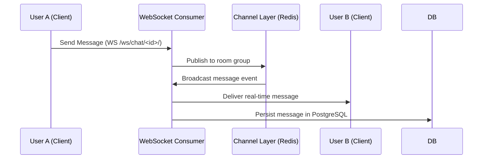

<div align="center">
  
  
  
  
  
  <br/>
  
  
  
  
  
  
  
</div>

<h1 align="center">Social Media Platform</h1>

<p align="center">
  <b>A production-ready social media application built with Django 5.2</b><br/>
  Real-time chat, stories, reactions, notifications, REST API, and comprehensive observability.<br/>
  Fully dockerized with multi-stage builds, CI/CD, 74 passing tests, and RTL Arabic/English i18n.
</p>

<p align="center">
  <a href="#features">Features</a> •
  <a href="#tech-stack">Tech Stack</a> •
  <a href="#architecture">Architecture</a> •
  <a href="#project-structure">Project Structure</a> •
  <a href="#quick-start">Quick Start</a> •
  <a href="#api">API</a> •
  <a href="#testing">Testing</a> •
  <a href="#troubleshooting">Troubleshooting</a> •
  <a href="#production">Production</a>
</p>

---

## Features

### User System

| Feature                                 | Status |
| --------------------------------------- | ------ |
| Registration with email verification    | ✅     |
| Login via email or username             | ✅     |
| Session-based authentication            | ✅     |
| Password reset flow (email-based)       | ✅     |
| Profile management with avatar upload   | ✅     |
| Account deletion                        | ✅     |
| Email change with password confirmation | ✅     |

### Social Features

| Feature                             | Status |
| ----------------------------------- | ------ |
| Text posts with image/video upload  | ✅     |
| Story sharing (24h auto-expiry)     | ✅     |
| 5-type reaction system              | ✅     |
| Threaded comments with replies      | ✅     |
| @mention and #hashtag auto-linking  | ✅     |
| Trending hashtags (cached)          | ✅     |
| Post bookmarking / saved posts      | ✅     |
| Cross-model search (posts + users)  | ✅     |

### Social Graph

| Feature                                    | Status |
| ------------------------------------------ | ------ |
| Follow/unfollow users                      | ✅     |
| Private accounts with follow requests      | ✅     |
| User blocking (auto-unfollows)             | ✅     |
| Followers/following lists                  | ✅     |

### Real-time Communication

| Feature                               | Status |
| ------------------------------------- | ------ |
| WebSocket-powered direct messaging    | ✅     |
| Real-time notification delivery       | ✅     |
| Rate-limited WebSocket consumers      | ✅     |

### Security

| Feature                                     | Status |
| ------------------------------------------- | ------ |
| Rate limiting on all sensitive endpoints    | ✅     |
| Profanity filter (form + model level)       | ✅     |
| Content moderation reports                  | ✅     |
| Multi-stage Docker (non-root user)          | ✅     |
| CORS configuration                          | ✅     |
| File upload validation (type + size)        | ✅     |
| Secure headers (HSTS, CSP, X-Frame-Options) | ✅     |
| XSS-safe template rendering                 | ✅     |
| No hardcoded secrets in image               | ✅     |

### Observability

| Feature                                  | Status |
| ---------------------------------------- | ------ |
| Sentry error tracking                    | ✅     |
| Structured JSON logging                  | ✅     |
| Rotating log files                       | ✅     |
| Health check endpoint (`/health/`)       | ✅     |
| Container HEALTHCHECK                    | ✅     |

### Internationalization

| Feature                   | Status |
| ------------------------- | ------ |
| English (en-us)           | ✅     |
| Arabic (ar) — RTL support | ✅     |

### UI/UX

| Feature                                     | Status |
| ------------------------------------------- | ------ |
| Dark mode (OS preference detection)         |         |
| Bootstrap 5 RTL responsive design           | ✅     |
| Open Graph meta tags for social sharing     | ✅     |
| AJAX reactions with WebSocket notifications | ✅     |
| Paginated feeds and API                     | ✅     |

---

## Tech Stack

<div align="center">

| Layer                | Technology                                           |
| -------------------- | ---------------------------------------------------- |
| **Backend**          | Django 5.2, Python 3.13                              |
| **API**              | Django REST Framework 3.15 + drf-spectacular         |
| **Real-time**        | Django Channels 4.0 + WebSockets                     |
| **Database**         | PostgreSQL 16 / SQLite 3                             |
| **Cache & Layer**    | Redis 7 / DatabaseCache (fallback)                   |
| **ASGI Server**      | Daphne                                               |
| **Frontend**         | Bootstrap 5.1, HTML5, CSS3, JavaScript               |
| **Forms**            | django-crispy-forms + crispy-bootstrap5              |
| **Rate Limiting**    | django-ratelimit 4.1                                 |
| **Background Tasks** | django-background-tasks                              |
| **Error Tracking**   | Sentry SDK                                           |
| **Logging**          | python-json-logger, RotatingFileHandler              |
| **CORS**             | django-cors-headers                                  |
| **Image Processing** | Pillow                                               |
| **Containerization** | Docker (multi-stage) + docker-compose                |
| **CI/CD**            | GitHub Actions                                       |

</div>

---

## Architecture

```
                    ┌─────────────────────────────────┐
                    │        Browser / Client          │
                    │  (Bootstrap 5 RTL + JS + WS)     │
                    └───────────────┬─────────────────┘
                                    │
                    ┌───────────────▼─────────────────┐
                    │         Daphne ASGI Server       │
                    │       (Django + Channels)        │
                    └──────┬──────────────────┬───────┘
                           │                  │
              ┌────────────▼──────┐  ┌────────▼────────┐
              │   HTTP Requests   │  │  WebSocket      │
              │   (REST API)      │  │  (Chat + Notif) │
              └────────┬─────────┘  └────────┬─────────┘
                       │                     │
              ┌────────▼─────────────────────▼─────────┐
              │          Django Application            │
              │                                        │
              │  ┌──────────┐ ┌──────────┐ ┌────────┐  │
              │  │  posts   │ │  users   │ │notific.│  │
              │  └──────────┘ └──────────┘ └────────┘  │
              │  ┌──────────┐ ┌──────────┐ ┌────────┐  │
              │  │direct_msg│ │ reports  │ │search  │  │
              │  └──────────┘ └──────────┘ └────────┘  │
              └──────────────────┬─────────────────────┘
                                 │
                    ┌────────────▼────────────┐
                    │       PostgreSQL         │
                    │     /  SQLite (dev)      │
                    └────────────┬────────────┘
                                 │
                    ┌────────────▼────────────┐
                    │     Redis (prod)         │
                    │  Cache + Channel Layer   │
                    └─────────────────────────┘
```

### System Architecture Flowchart

```mermaid
graph TD
    Client[Browser / Client (Bootstrap 5 RTL + WS)] -->|HTTP / REST API| Daphne[Daphne ASGI Server]
    Client -->|WebSocket (WSS)| Daphne
    Daphne --> Django[Django 5.2 Application Core]
    subgraph Django Apps
        Django --> Posts[Posts & Stories]
        Django --> Users[Users & Social Graph]
        Django --> Chat[Direct Messages]
        Django --> Notif[Notifications]
        Django --> Search[Search & Reports]
    end
    Django --> DB[(PostgreSQL / SQLite)]
    Django --> Redis[(Redis 7 Cache & Channel Layer)]
```

### Real-Time WebSocket Messaging Sequence



---

## Project Structure

```text
socialmedia-app/
├── direct_messages/         # WebSocket chat & real-time messaging
├── docs/                    # Architecture & deployment guides
├── middleware/              # Rate limiting & exception handlers
├── notifications/           # Real-time and persistent user notifications
├── posts/                   # Posts, stories, comments, reactions, hashtags
├── reports/                 # Content moderation and abuse reporting
├── searchapp/               # Cross-model search engine (posts & users)
├── socialmediaproject/      # Django settings, ASGI/WSGI routing, URLs
├── static/                  # Stylesheets, custom CSS, JS assets
├── templates/               # Global and app-specific HTML templates
├── utils/                   # File validation and security utilities
├── docker-compose.yml       # Production/dev container orchestration
├── Dockerfile               # Multi-stage secure container build
├── manage.py                # Django CLI management utility
└── requirements.txt         # Python dependencies
```

---

## Quick Start

### Docker (Recommended)

```bash
# Clone and run
git clone https://github.com/A0x0k/socialmedia-app.git
cd socialmedia-app

# Copy environment file and edit with your values
cp .env.example .env

# Build and start
docker compose up --build
```

The app will be available at `http://localhost:8000`.  
Swagger docs at `http://localhost:8000/api/docs/`.  
Health check at `http://localhost:8000/health/`.

### Manual Setup

```bash
git clone https://github.com/A0x0k/socialmedia-app.git
cd socialmedia-app

# Create virtual environment
python -m venv venv
source venv/bin/activate  # Linux/Mac
venv\Scripts\activate     # Windows

# Install dependencies
pip install -r requirements.txt

# Set environment variables
cp .env.example .env
# Edit .env with your SECRET_KEY and other settings

# Run migrations
python manage.py migrate

# Create superuser
python manage.py createsuperuser

# Start development server
python manage.py runserver
```

> **Note**: Without Redis, the app automatically falls back to DatabaseCache and InMemoryChannelLayer.

---

## Environment Variables

```env
# ─── Required ─────────────────────────────────────
SECRET_KEY=<random-64-char-string>

# ─── Django ───────────────────────────────────────
DEBUG=True                          # Set False in production
ALLOWED_HOSTS=localhost,127.0.0.1  # Comma-separated

# ─── Database (PostgreSQL — optional, defaults to SQLite) ──
DB_NAME=socialmedia_db
DB_USER=postgres
DB_PASSWORD=password
DB_HOST=localhost
DB_PORT=5432

# ─── Redis ─────────────────────────────────────────
REDIS_URL=redis://localhost:6379/1  # Falls back to DB cache

# ─── Email (for password reset) ────────────────────
EMAIL_HOST=smtp.gmail.com
EMAIL_PORT=587
EMAIL_USE_TLS=True
EMAIL_HOST_USER=your-email@gmail.com
EMAIL_HOST_PASSWORD=your-app-password
DEFAULT_FROM_EMAIL=your-email@gmail.com

# ─── Sentry (optional) ─────────────────────────────
# SENTRY_DSN=https://key@sentry.io/project

# ─── CORS (optional) ──────────────────────────────
# CORS_ALLOWED_ORIGINS=http://localhost:8000,https://yourdomain.com
```

---

## API

Interactive Swagger documentation is available at `/api/docs/` when the server is running.

### Key REST Endpoints

| Method | Endpoint                    | Description          |
| ------ | --------------------------- | -------------------- |
| `GET`  | `/api/posts/`               | Paginated post list  |
| `GET`  | `/posts/hashtag/<name>/`    | Posts by hashtag     |
| `GET`  | `/posts/trending/`          | Trending hashtags    |
| `POST` | `/posts/<id>/react/`        | React to a post      |
| `GET`  | `/health/`                  | DB + cache liveness  |

### WebSocket Endpoints

| Endpoint                               | Description             |
| -------------------------------------- | ----------------------- |
| `ws://host/ws/chat/<conversation_id>/` | Real-time chat          |
| `ws://host/ws/notifications/`          | Real-time notifications |

### Example cURL Request

```bash
# Fetch health status
curl -X GET http://localhost:8000/health/
```

---

## Testing

```bash
# Run all 74 tests
python manage.py test

# Run specific app tests
python manage.py test posts
python manage.py test users
python manage.py test direct_messages
python manage.py test notifications
python manage.py test reports
python manage.py test searchapp

# Run with verbose output
python manage.py test --verbosity=2

# Check for system issues
python manage.py check --deploy
```

### Test Coverage

| Test Suite                 | Tests | Areas Covered                                                      |
| -------------------------- | ----- | ------------------------------------------------------------------ |
| `posts/tests.py`           | 24    | Models, forms, views, profanity filter, bookmarks, file validation |
| `users/tests.py`           | 12    | Profile CRUD, follows, blocks, privacy, settings, email/password   |
| `notifications/tests.py`   | 7     | Model, utility function, list view, unread count, mark read        |
| `reports/tests.py`         | 8     | Model validation, report creation, admin views, resolution         |
| `direct_messages/tests.py` | 11    | Conversation model, message model, inbox, conversation detail      |
| `searchapp/tests.py`       | 7     | Basic search, advanced search, date range, empty query, no results |
| `channels` (implied)       | 5     | WebSocket consumers (notification + chat)                          |
| **Total**                  | **74** | **All passing**                                                   |

---

## Troubleshooting

### Common Issues & Solutions

1. **Redis Connection Warnings**:
   - *Symptom*: Logs show inability to connect to Redis.
   - *Solution*: The application is designed to gracefully fallback to Django's `DatabaseCache` and `InMemoryChannelLayer`. For multi-worker production, ensure Redis service is running and `REDIS_URL` is correctly configured in `.env`.
2. **WebSocket Connection Failures**:
   - *Symptom*: Chat or notifications fail to connect via WebSocket.
   - *Solution*: Ensure you are running the ASGI server (Daphne or Uvicorn) rather than the standard WSGI development server (`python manage.py runserver`).
3. **Database Migration Issues**:
   - *Symptom*: Missing tables or column errors.
   - *Solution*: Run `python manage.py migrate` to apply all pending migrations across all apps.

---

## Docker

```bash
# Build and start with multi-stage build
docker compose up --build

# Run migrations
docker compose exec web python manage.py migrate

# Create superuser
docker compose exec web python manage.py createsuperuser

# Run tests inside container
docker compose exec web python manage.py test

# Cleanup expired stories
docker compose exec web python manage.py cleanup_stories

# View health status
docker compose ps
```

---

## Production

### Pre-deployment Checklist

- [ ] Set `DEBUG=False` in `.env`
- [ ] Generate a strong `SECRET_KEY`
- [ ] Configure `ALLOWED_HOSTS` with your domain(s)
- [ ] Set up PostgreSQL and update DB env vars
- [ ] Configure Redis URL
- [ ] Set `SENTRY_DSN` for error tracking
- [ ] Set `CORS_ALLOWED_ORIGINS` with your frontend domain(s)
- [ ] Configure email backend for password reset
- [ ] Set up AWS S3 for media file storage (optional)
- [ ] Run `python manage.py check --deploy` and address any warnings

### Running in Production

```bash
# Build for production
docker compose -f docker-compose.yml up --build -d

# Apply migrations
docker compose exec web python manage.py migrate

# Collect static files
docker compose exec web python manage.py collectstatic --noinput

# Create cache table
docker compose exec web python manage.py createcachetable

# Verify health
curl http://localhost:8000/health/
```

---

## Contributing

Contributions are welcome!

1. **Fork** the repository
2. **Create** a feature branch: `git checkout -b feature/amazing-feature`
3. **Commit** your changes with descriptive messages (`git commit -m 'feat: add amazing feature'`)
4. **Run tests** to ensure nothing breaks: `python manage.py test`
5. **Push** to your branch: `git push origin feature/amazing-feature`
6. **Open** a Pull Request

---

## License

This project is licensed under the MIT License — see the [LICENSE](LICENSE) file for details.

---

<div align="center">
  <b>Built with Django</b><br/>
  <sub>Maintained by <a href="https://github.com/A0x0k">A0x0k</a> • Star this repo if you find it useful!</sub>
</div>
